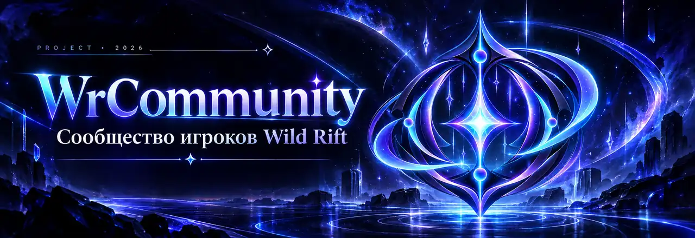

<div align="center">



<br>

**Независимое русскоязычное сообщество игроков League of Legends: Wild Rift**

Профиль. Публикации. Подписки. Люди, с которыми хочется играть.


[Демо главной v6](prototypes/home/v6/index.html) · [Концепция](#о-проекте) · [Функции](#возможности) · [План развития](docs/ROADMAP.md) · [Спецификация](docs/specs/social-core-v1.md) · [Участие](CONTRIBUTING.md)

</div>

---

## О проекте

**WrCommunity** — рабочее название нового независимого мобильного веб-сообщества для русскоязычных игроков Wild Rift. Здесь игроки смогут находить единомышленников, подписываться на авторов, публиковать записи, обсуждать игру и объединяться в клубы.

В центре продукта — **социальные связи, которые живут между матчами**. Первый сценарий: познакомиться с открытой лентой → создать профиль → подписаться → поучаствовать в обсуждении или написать собственный пост.

> [!IMPORTANT]
> **Статус: проектирование.** Работающего веб-сайта, приложения, релиза или развёрнутого сервера в этом репозитории пока нет. Все функции ниже запланированы, а не реализованы.

## Возможности

| Направление | Что планируется | Статус |
|:--|:--|:--|
| **Главная** | Гибридная лента, интерактивные карточки, люди и клубы | Проектируется |
| **Профили** | Аватар, обложка, сведения об игроке, публичный/скрытый режим | Спецификация v1 |
| **Социальный граф** | Подписки, отписки, полная блокировка | Спецификация v1 |
| **Публикации** | Посты, изображения, комментарии, реакции, закладки | Спецификация v1 |
| **Обнаружение** | Просмотр публичного контента и поиск участников | Проектируется |
| **Клубы** | Группы по интересам и совместные обсуждения | Следующая спецификация |
| **Сообщения** | Переписка участников | Будущая фаза |
| **Модерация** | Жалобы, правила, контроль доступа | Требования в Social Core v1 |

### Приватность — не декоративная настройка

- **Гости** смогут читать публичные профили и публикации, без права социальных действий.
- **Скрытый профиль** не раскрывает страницу и собственные публикации посторонним.
- **Комментарии скрытого автора** под чужими публичными постами сохраняют его ник, но не дают открыть профиль.
- **Полная блокировка** запрещает прямое взаимодействие в обе стороны и прекращает подписки.
- **Старые комментарии после блокировки** сохраняются для остальных участников, но скрываются между сторонами блокировки.

Детали и открытые решения: [Social Core v1](docs/specs/social-core-v1.md).

## Подход к продукту

**Mobile-first.** Удобная навигация большим пальцем, доступная типографика, быстрые взаимодействия и аккуратная адаптация для компьютера.

**Без выдуманной активности.** На сайте не должно быть фиктивных участников, фальшивых реакций и придуманной статистики.

**Сначала дизайн и правила, затем код.** Спецификации обсуждаются и утверждаются до реализации. Неутверждённые технологии и особенности не считаются принятыми решениями.

## Состояние разработки

```text
ПРОДУКТ                       ПРОЕКТИРОВАНИЕ
Концепция и аудитория         ● зафиксированы
Social Core v1               ◐ документ на ревью
Клубы и социальные группы    ○ ещё не специфицированы
UX / UI дизайн               ○ впереди
Техническая архитектура      ○ впереди
Код сайта                    ○ не начат
```

[Дорожная карта и критерии перехода](docs/ROADMAP.md).

## Текущий дизайн-прототип

**Главная v6 — Editorial Social** зафиксирована как базовый вариант для дальнейших изменений: [интерактивный HTML](prototypes/home/v6/index.html) и [инструкция](prototypes/home/v6/README.md). Это автономный прототип с примерами контента, без аккаунтов, базы данных и сервера. Чтобы использовать интерактивность, скачайте HTML и откройте его в браузере; GitHub показывает исходный код, а не исполняет HTML.

## Документация

| Файл | Назначение |
|:--|:--|
| [docs/README.md](docs/README.md) | Навигация по документации |
| [docs/specs/social-core-v1.md](docs/specs/social-core-v1.md) | Социальное ядро: доступ, приватность, подписки, блокировки |
| [docs/ROADMAP.md](docs/ROADMAP.md) | Порядок подготовки и реализации |
| [docs/design/visual-directions-v1.md](docs/design/visual-directions-v1.md) | Три визуальных направления мобильного сайта для обсуждения |
| [docs/BRAND.md](docs/BRAND.md) | Принципы визуального языка и бренд-материалы |
| [CONTRIBUTING.md](CONTRIBUTING.md) | Как предлагать улучшения |
| [SECURITY.md](SECURITY.md) | Как сообщать об уязвимостях |

## Структура репозитория

```text
WrCommunity/
├── assets/
│   └── brand/                # Исходные SVG-материалы
├── docs/
│   ├── specs/                # Продуктовые спецификации
│   ├── BRAND.md              # Визуальные принципы
│   ├── ROADMAP.md            # Дорожная карта
│   └── README.md             # Навигация по документам
├── .github/
│   ├── ISSUE_TEMPLATE/       # Формы идей и проблем
│   └── PULL_REQUEST_TEMPLATE.md
├── CONTRIBUTING.md
├── SECURITY.md
└── README.md
```

## Участие

Предложить улучшение можно через [Issues](https://github.com/lolokeksu09/WrCommunity/issues) или обсуждение существующей спецификации. Перед отправкой кода прочитайте [правила участия](CONTRIBUTING.md): архитектура ещё не утверждена.

**Лицензия пока не выбрана.** Публичная доступность репозитория сама по себе не предоставляет разрешения на копирование, изменение или распространение материалов. Условия участия и лицензирования будут определены отдельно.

## Правовой статус

**WrCommunity — независимый фанатский проект.** Не связан с Riot Games и не поддерживается Riot Games. Названия *League of Legends* и *Wild Rift* используются для обозначения тематики сообщества и принадлежат своим правообладателям. Фирменный знак WrCommunity и SVG-баннер созданы отдельно и не используют графику Riot.

<div align="center">
  <sub>WrCommunity · Твои люди. Твоя игра. · В разработке</sub>
</div>

## Проектная документация WrCommunity v1

В репозитории опубликован комплект проектной документации: [функциональные требования, экранные маршруты, решения, архитектура и этапы реализации](docs/specs/wrcommunity-v1/README.md). Контракт Social Core v1 расширен правилами клубов, мероприятий и LFG; это **спецификация**, а не готовые функции сайта. Существующий прототип главной v6 сохраняется в прежнем виде.

Перед разработкой необходимо пройти ревью контрактов доступа и прав на пользовательский/игровой контент. Реализация и автоматизированные проверки будут выполняться отдельными инкрементами.
