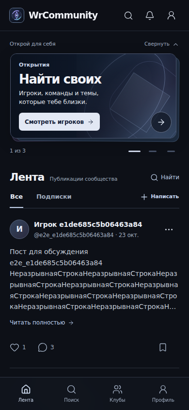
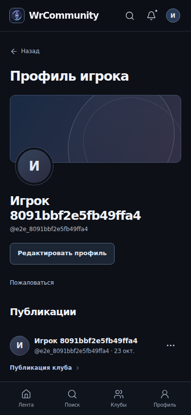
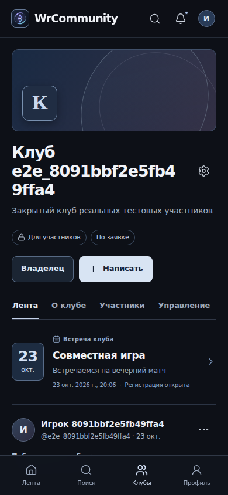
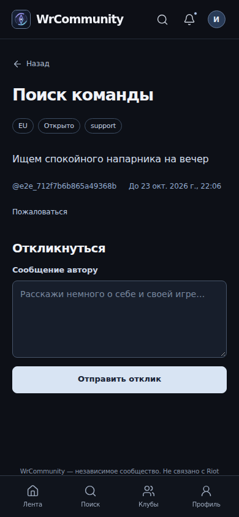
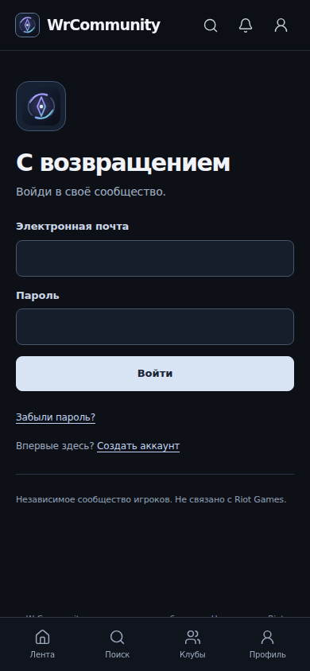
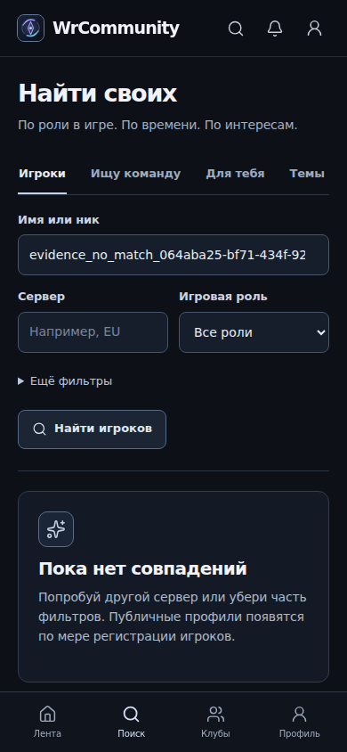

# Скриншоты работающего приложения

Снимки реального Chromium 156 с изолированной PostgreSQL и тестовыми учётными записями. Это не макеты и не демонстрационная активность установленного продукта. Сайт после установки пуст; данные для этих кадров создавались API/браузерными тестами. Визуальная точка — сохранённый v6.

| Главная, 390 CSS px | Профиль, 390 CSS px |
|---|---|
|  |  |
| Клуб | Поиск команды |
|  |  |
| Вход | Пустая выдача |
|  |  |

Десктоп: [главная](home-1440.png), [профиль](profile-1440.png), [клуб](club-1440.png), [LFG](lfg-1440.png), [вход](login-1440.png), [пустая выдача](empty-1440.png).

| CSS px | Главная | Загрузка | Пустая выдача | Ошибка |
|---|---|---|---|---|
| 360 | [Снимок](responsive-desktop-home-360.png) | [Снимок](responsive-desktop-loading-360.png) | [Снимок](responsive-desktop-empty-360.png) | [Снимок](responsive-desktop-error-360.png) |
| 390 | [Снимок](responsive-desktop-home-390.png) | [Снимок](responsive-desktop-loading-390.png) | [Снимок](responsive-desktop-empty-390.png) | [Снимок](responsive-desktop-error-390.png) |
| 430 | [Снимок](responsive-desktop-home-430.png) | [Снимок](responsive-desktop-loading-430.png) | [Снимок](responsive-desktop-empty-430.png) | [Снимок](responsive-desktop-error-430.png) |
| 1440 | [Снимок](responsive-desktop-home-1440.png) | [Снимок](responsive-desktop-loading-1440.png) | [Снимок](responsive-desktop-empty-1440.png) | [Снимок](responsive-desktop-error-1440.png) |

Загрузка снята при настоящем ожидании сети; запросы и ответы не подменялись. [Манифест основных кадров](manifest.json) содержит размеры, заголовки, отсутствие page errors и проверку overflow. [Манифест адаптивности](responsive-manifest.json) связывает физические размеры снимка и CSS viewport. Высокоплотные дубликаты мобильного проекта доступны в CI browser-evidence artifact.
